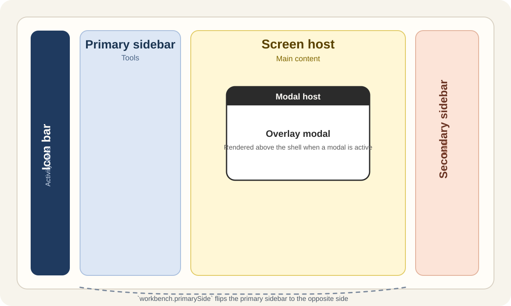

# Getting Started

## Install

```bash
bun add @artisansdk/workbench
```

React usage expects these peer dependencies to be present:

- `react`
- `react-dom`
- `typescript`
- `valtio` (v2)

## Smallest React setup

```tsx
import { Workbench, Plugin } from "@artisansdk/workbench"
import { Shell, CommandPalettePlugin } from "@artisansdk/workbench/react"

function HomeScreen() {
    return <div>Home</div>
}

class HomePlugin extends Plugin {
    // This id is unique across all registered plugins
    readonly id = "home"

    register(workbench: Workbench) {
        workbench.screen({ id: "home", component: HomeScreen })

        workbench.activity({
            id: "home",
            label: "Home",
            icon: <span>H</span>,
            activates: { screen: "home" },
        })
    }

    boot(workbench: Workbench) {
        workbench.activate("home")
    }
}

const workbench = new Workbench()
    .use(new HomePlugin())
    .use(new CommandPalettePlugin())
    .boot()

export default function App() {
    return <Shell workbench={workbench} />
}
```

## Boot order

Workbench's init phase runs in two passes:

1. Every plugin gets `register()`.
2. Every plugin then gets `boot()`.

That means plugins can assume all contributions are registered before any `boot()` logic runs.

## Core shell regions



- Icon bar: activity items
- Primary sidebar: tools
- Screen host: main content
- Secondary sidebar: tools
- Modal host: overlays

Which side the primary sidebar appears on is controlled by `workbench.primarySide`.

## Required state for first-party plugins

If a plugin sets `required = true` and is registered as `first-party`, Workbench will not allow it to be disabled at runtime.
